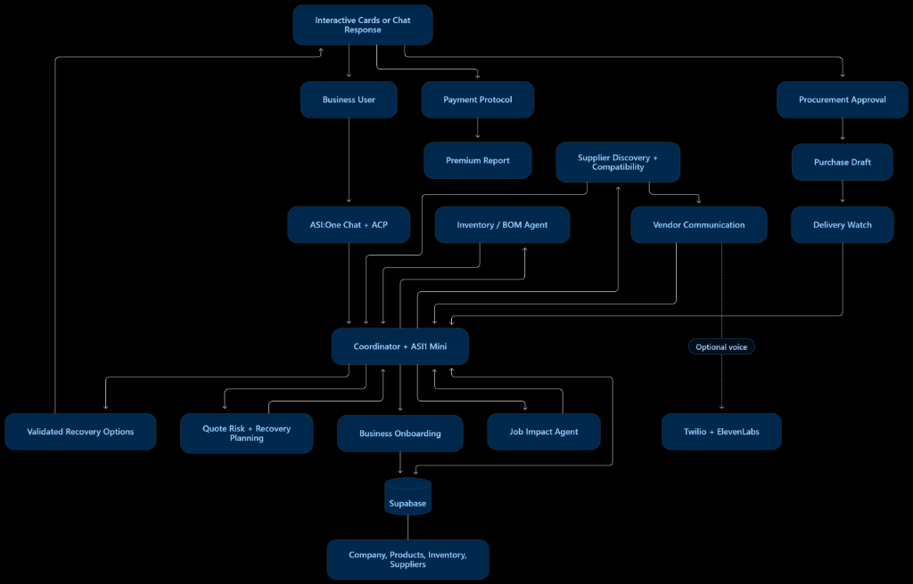
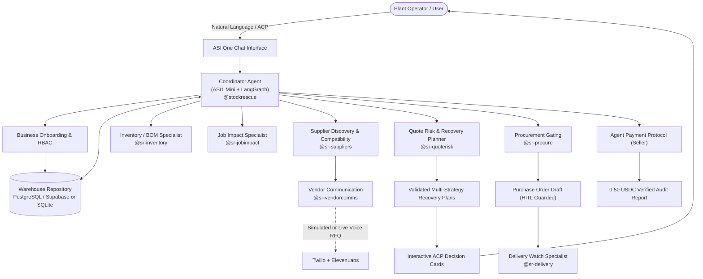

# StockRescue

<p align="center">
  
</p>


[](https://github.com/vivinarya/stckresc/actions/workflows/backend-ci.yml)
[](https://www.python.org/downloads/)
[](LICENSE)

**Autonomous Multi-Agent Industrial Supply Chain Disruption Recovery**

StockRescue is an autonomous, synchronized multi-agent recovery platform designed to mitigate factory downtime and critical material shortages. When a primary supplier delays or cancels an order, StockRescue calculates production line downtime exposure, verifies OEM component engineering compatibility, sources certified regional distributors, computes cost-optimal recovery options, generates signed purchase order drafts, and tracks inbound logistics milestones—all initiated from a single natural language message.

[Chat with @stockrescue on ASI:One](https://asi1.ai/) · [Agentverse Portal](https://agentverse.ai/) · [Supabase Console](https://supabase.com/)

---

## Table of Contents

- [The Problem](#the-problem)
- [What StockRescue Does](#what-stockrescue-does)
  - [Live Execution Timeline](#live-execution-timeline)
- [System Architecture](#system-architecture)
- [Specialist Agent Network](#specialist-agent-network)
  - [Consolidated 8-Identity Mailbox Architecture](#consolidated-8-identity-mailbox-architecture)
- [Coordinator Tool Suite (14 Approved Tools)](#coordinator-tool-suite-14-approved-tools)
- [Core Architectural Principles](#core-architectural-principles)
- [Repository Structure](#repository-structure)
- [Prerequisites & External Services](#prerequisites--external-services)
- [Quickstart & Installation](#quickstart--installation)
  - [1. Clone Repository](#1-clone-repository)
  - [2. Virtual Environment Setup](#2-virtual-environment-setup)
  - [3. Environment Configuration](#3-environment-configuration)
  - [4. Running the Warehouse API Service](#4-running-the-warehouse-api-service)
  - [5. Interactive Terminal Chat](#5-interactive-terminal-chat)
  - [6. Running Scenario Demos](#6-running-scenario-demos)
  - [7. Agentverse Cloud Deployment](#7-agentverse-cloud-deployment)
- [Testing & Quality Verification](#testing--quality-verification)
- [API & Integration Specifications](#api--integration-specifications)
- [Configuration Reference](#configuration-reference)
- [Contributing](#contributing)
- [Roadmap & Future Improvements](#roadmap--future-improvements)

---

## The Problem

Modern industrial manufacturing, process plants, and assembly facilities face massive financial and operational losses when critical components are delayed:

- **Catastrophic Downtime Costs:** Production line outages frequently cost between \$10,000 and \$250,000 per hour in idle labor, machine restart delays, and missed customer shipments.
- **Fragmented Inventory Visibility:** Stock balances are dispersed across segregated warehouses, bin locations, and pre-allocated customer orders.
- **Single-Source Vulnerability:** Reliance on single-source suppliers exposes plant operations to unilateral shipping delays, factory fires, and allocation cuts.
- **Engineering Specification Risk:** Substituting heavy industrial parts (bearings, valves, high-pressure pipes, motors) requires rigorous verification of pressure ratings, dimensions, metallurgy, and tolerances.
- **Procurement Governance Safeguards:** Autonomous AI systems cannot be granted unchecked purchasing authority; corporate policy requires auditable purchase order drafts and strict Human-in-the-Loop (HITL) approval gates.

---

## What StockRescue Does

Operators interact with **@stockrescue** over the **Agent Chat Protocol (ACP)** on **ASI:One**:

> *"Our main supplier delayed a critical component (PIPE-4IN-SCH40) and two jobs may be affected. Check our profile, investigate the shortage, and find the safest recovery plan."*

### Live Execution Timeline

| Elapsed | Agent Execution Milestone |
|---|---|
| **0s** | **Coordinator + ASI1 Mini** parses the disruption report, verifies business profile and organization authorization in the repository, and binds case context (`CASE-PIPE-001`). |
| **8s** | **Inventory / BOM Agent** reconciles physical on-hand inventory (20 units) against committed allocations (15 units), determining 5 available units against total demand (35 units) and isolating a net shortfall of 30 units. |
| **14s** | **Job Impact Agent** evaluates work orders across Line 1 Scheduled Maintenance and Line 2 Expansion, scoring hourly downtime loss rates and deadline breach exposure. |
| **24s** | **Supplier Discovery & Compatibility Specialist** filters out the defaulting supplier, queries certified distributor inventories (Apex Industrial Supply, Midwest Piping Corp), and verifies exact ASTM/ANSI specification compliance. |
| **36s** | **Quote Risk & Recovery Planner** normalizes minimum order quantities (MOQ), freight surcharges, and transit windows. Formulates an optimal recovery plan (\$1,395.00 total landed cost). |
| **45s** | **Interactive ACP Cards** render in ASI:One chat: Impact Detail Card, Plan Comparison Carousel, and Draft Purchase Order Card. |
| **60s** | **Vendor Communication & Voice Specialist** drafts structured RFQ inquiries. Integrates with ElevenLabs and Twilio for automated phone inquiries (runs in safe simulation mode during testing). |
| **90s** | **Procurement Specialist** generates a signed, cryptographic purchase order draft (`PO-DRAFT-SR-5FF464`) locked to the canonical plan hash, awaiting authorized operator review. |
| **120s** | **Delivery Watch Specialist** monitors carrier tracking milestones (`HOTSHOT-IND-9921`) to verify arrival before scheduled shift start. |

---

## System Architecture





---

## Specialist Agent Network

Every specialist agent runs as an autonomous uAgent micro-service registered on the Fetch.ai Agentverse network:

| Agent Name | Agentverse Handle | Address | Core Responsibility |
|---|---|---|---|
| **StockRescue Coordinator** | `@stockrescue` | `agent1qwftafhh6kekpkzqxh4mdzuvnphhqrqkwxfxgnaccde3fms6r65svnk0cma` | ACP conversational orchestrator, ASI1 Mini reasoning loop, card builder, HITL gate enforcement. |
| **Inventory & BOM** | `@sr-inventory` | `agent1qvwmvakw2y7s0u4vj2sqcgz9y7ty2fxrg8c5vvgzlw4r70mmz3xpuppm4cr` | Reconciles physical stock vs. committed reserves; computes net part shortfall. |
| **Job Impact** | `@sr-jobimpact` | `agent1qwpes68a2as0hh3yahxzz78266agt6ten4ykny3xmqcyc56fhkds7388fln` | Evaluates production job criticality (1–10), hourly downtime loss, and SLA breach risk. |
| **Supplier Discovery** | `@sr-suppliers` | `agent1q0ac6fztvpvzuf0kegpek9wl5qnuv26f29aeny7rluygkg56z9d0gygf3vh` | Discovers replacement distributors, blacklists failed vendors, queries regional catalogs. |
| **Quote Risk & Planner** | `@sr-quoterisk` | `agent1q2nn70ng2g6d5ccpz87a3ng8kaswyu6me8c4tfjp4zfma0twztstgulm5mz` | Normalizes commercial quotes, MOQ penalties, and computes multi-strategy recovery options. |
| **Procurement Specialist** | `@sr-procure` | `agent1qggs7dy7ky0fza48dpwjqhfnfrrmq2mxg5d8hdvl8x064xhfhqdtwv82wzg` | Assembles auditable purchase order drafts with cryptographic plan fingerprinting. |
| **Vendor Voice & Comms** | `@sr-vendorcomms` | `agent1q2ts3pay9rd0zvyk6r5y4f46avu3zl5ft33yvdjv2fxta24k5the5vua4vr` | Synthesizes negotiation transcripts and bridges automated voice inquiries via ElevenLabs/Twilio. |
| **Delivery Watch** | `@sr-delivery` | `agent1q29xxmnpfh4vkjanmhd7hzt4jgjxk6fhur2pwgzn85l6xcdfgpdcggkqlhx` | Ingests carrier tracking events, detects schedule variance, and raises delivery alerts. |

*Agent profiles can be inspected directly on Agentverse at: `https://agentverse.ai/agents/details/<address>/profile`*

### Consolidated 8-Identity Mailbox Architecture

To operate within Agentverse mailbox quotas while delivering all 9 specialist capabilities, the system consolidates complementary tasks into 8 physical mailbox identities:
1. **Coordinator** (`@stockrescue`)
2. **Inventory/BOM** (`@sr-inventory`)
3. **Job Impact** (`@sr-jobimpact`)
4. **Supplier Sourcing** (`@sr-suppliers`): Handles both Supplier Discovery and Engineering Compatibility verification (`AGENTVERSE_COMPATIBILITY_ADDRESS` points to the same mailbox).
5. **Quote & Planning** (`@sr-quoterisk`): Handles both Quote Risk assessment and Recovery Plan optimization (`AGENTVERSE_RECOVERY_PLANNER_ADDRESS` points to the same mailbox).
6. **Procurement** (`@sr-procure`)
7. **Vendor Communication** (`@sr-vendorcomms`)
8. **Delivery Watch** (`@sr-delivery`)

---

## Coordinator Tool Suite (14 Approved Tools)

The Coordinator's ASI1 Mini orchestrator uses a bounded tool loop calling 14 specialist functions:

| # | Tool Function | Purpose & Operational Functionality |
|---|---|---|
| 1 | `check_business_profile_and_case_context` | Verifies authorized business profile, organization memberships, and case registration. |
| 2 | `get_case_context` | Retrieves active case details, affected SKU, active jobs, inventory balances, and supplier offers. |
| 3 | `analyze_inventory_bom` | Evaluates warehouse inventory balances, committed reserves, and calculates net shortfall. |
| 4 | `assess_job_impact` | Computes work-order urgency (1–10), line criticality, and hourly downtime loss rate. |
| 5 | `discover_suppliers` | Identifies qualified regional distributors while blacklisting failed suppliers. |
| 6 | `check_compatibility` | Verifies engineering compatibility between primary and candidate substitute SKUs. |
| 7 | `assess_quotes` | Evaluates distributor quotes, MOQ penalties, freight surcharges, and financial risk scores. |
| 8 | `generate_recovery_options` | Synthesizes multi-strategy recovery plans (Speed Expedited, Balanced, Cost-Optimized). |
| 9 | `get_plan_details` | Retrieves itemized line items, allocated suppliers, and delivery schedules for a plan. |
| 10 | `prepare_vendor_communication` | Drafts structured vendor inquiries and expedite requests for human operator review. |
| 11 | `request_vendor_quote_by_voice` | Simulates or initiates supplier inquiry calls via ElevenLabs/Twilio voice agent. |
| 12 | `get_delivery_status` | Retrieves carrier tracking events, transit delays, and delivery ETA status. |
| 13 | `prepare_procurement_draft` | Compiles a formal purchase order draft locked to the plan's cryptographic hash. |
| 14 | `request_premium_report_payment` | Initiates the Fetch.ai Payment Protocol (0.50 USDC) to unlock verified audit reports. |

---

## Core Architectural Principles

1. **Deterministic Business Authority:** Inventory arithmetic, bill-of-materials demand, engineering tolerance compatibility, and landed cost optimization are computed by deterministic Python engines. The LLM acts as an orchestrator and translator—never as an unchecked authority for stock levels, pricing, or safety approvals.
2. **Strict Human-in-the-Loop Governance:** Live automated spending is permanently disabled (`REAL_PURCHASING_ENABLED=false`). Purchase orders are prepared as cryptographically signed drafts requiring operator sign-off.
3. **Cryptographic Canonical Plan Fingerprinting:** Every recovery plan is hashed using canonical JSON representation (SHA-256). Approvals and purchase order drafts bind strictly to this fingerprint, ensuring plan tampering is detected immediately.
4. **Agent Payment Protocol (Seller Service):** Implements the Fetch.ai Payment Protocol specification via Skyfire, allowing external users to purchase unredacted contingency audit packs for 0.50 USDC.
5. **Zero-Idle Sleep Model:** Cloud agents operate without continuous polling loops (`@agent.on_interval`), waking up in ~50ms upon receiving protocol messages and returning immediately to hibernation to conserve compute quotas.

---

## Repository Structure

```
stckresc/
├── .github/
│   └── workflows/
│       └── backend-ci.yml           # GitHub Actions CI for linting and test execution
├── backend/
│   ├── agents/                      # Autonomous uAgents specialist implementations
│   │   ├── coordinator/             # Master orchestrator, ACP cards, LangGraph workflow
│   │   ├── inventory_bom/           # Warehouse stock and BOM reconciliation specialist
│   │   ├── job_impact/              # Production line downtime risk evaluator
│   │   ├── supplier_discovery/      # Supplier sourcing and distributor search
│   │   ├── compatibility/           # OEM engineering specification compatibility
│   │   ├── quote_risk/              # Quote risk scoring and cost normalization
│   │   ├── recovery_planner/        # Mathematical recovery plan optimization
│   │   ├── procurement/             # Purchase order draft assembly and approval gating
│   │   ├── vendor_voice/            # Voice call negotiation simulator and transcript logger
│   │   └── delivery_watch/          # Logistics tracking and shipment delay monitoring
│   ├── docs/
│   │   ├── ARCHITECTURE.md          # Comprehensive multi-agent architecture overview
│   │   └── DEPLOYMENT.md            # Agentverse deployment and avctl hosting guide
│   ├── observability/               # Langfuse tracing and telemetry instrumentation
│   │   └── langfuse_tracker.py
│   ├── scripts/                     # Utility, demo, and migration scripts
│   │   ├── chat_coordinator_local.py
│   │   ├── demo_priya_rescue.py
│   │   ├── migrate_sqlite_to_postgres.py
│   │   ├── seed_demo_data.py
│   │   ├── smoke_test_agentverse.py
│   │   └── test_live_coordinator.py
│   ├── services/                    # Core service integration layers
│   │   ├── warehouse_api/           # FastAPI REST API, schemas, auth, and repositories
│   │   ├── voice_service/           # Twilio and ElevenLabs voice telephony handlers
│   │   └── payment_provider/        # Fetch.ai / Skyfire payment integration
│   ├── shared/                      # Pydantic domain models, configuration, state machines
│   ├── tests/                       # Pytest test suite (180+ tests)
│   ├── tools/                       # Deterministic computation algorithms
│   ├── .env.example                 # Environment configuration template
│   ├── FRONTEND_INTEGRATION_CONTRACT.md # Authoritative API and ACP contract for UI clients
│   ├── pytest.ini                   # Pytest configuration
│   ├── README.md                    # Backend-specific quickstart and overview
│   └── requirements.txt             # Python dependencies
├── docs/
│   ├── architecture_diagram.png     # Visual architecture diagram
│   └── logo.jpg                     # StockRescue project logo
├── CONTRIBUTING.md                  # Contribution guidelines and coding standards
├── .gitignore                       # Git ignore patterns
└── README.md                        # Master project documentation (this file)
```

---

## Prerequisites & External Services

### Local Environment
- **Python:** Version 3.11 or 3.12 (Python 3.11 recommended)
- **Git:** Version 2.40+
- **Operating System:** Linux, macOS, or Windows (PowerShell / Command Prompt)

### External Services & Platforms (Production)
- **[Fetch.ai Agentverse](https://agentverse.ai/):** Cloud hosting environment for autonomous uAgents, Almanac identity indexing, and mailbox transport.
- **[ASI:One Developer Platform](https://asi1.ai/):** Access to the `asi1-mini` reasoning model and ACP client.
- **[Fetch.ai avctl CLI](https://fetch.ai/docs/tools/avctl):** Command-line tool for packaging and deploying agents to Agentverse.
- **[Supabase (PostgreSQL)](https://supabase.com/):** Cloud PostgreSQL database for multi-tenant organizations, disruption cases, and audit trails (local SQLite supported for dev/test).
- **[ElevenLabs](https://elevenlabs.io/):** Conversational AI voice agents for supplier quote calls.
- **[Twilio](https://www.twilio.com/):** Telephony media streaming and outbound calling bridge.
- **[Langfuse](https://langfuse.com/):** Observability, LLM tracing, and latency monitoring.
- **[Skyfire](https://skyfire.xyz/):** Non-custodial Web3 payment gateway for Agent Payment Protocol.

---

## Quickstart & Installation

### 1. Clone Repository
```bash
git clone https://github.com/vivinarya/stckresc.git
cd stckresc
```

### 2. Virtual Environment Setup

**Linux / macOS:**
```bash
python3 -m venv .venv
source .venv/bin/activate
pip install --upgrade pip
pip install -r backend/requirements.txt
```

**Windows (PowerShell):**
```powershell
python -m venv .venv
.\.venv\Scripts\Activate.ps1
python -m pip install --upgrade pip
pip install -r backend\requirements.txt
```

### 3. Environment Configuration
Copy the template configuration into `backend/.env`:

```bash
# Linux / macOS
cp backend/.env.example backend/.env

# Windows (PowerShell)
Copy-Item backend\.env.example backend\.env
```

Edit `backend/.env` with your credentials:
```ini
# Core LLM Orchestration
ASI_ONE_API_KEY=your_asi_one_api_key
ASI_ONE_BASE_URL=https://api.asi1.ai/v1
ASI_ONE_MODEL=asi1-mini

# Database (use sqlite for local dev, postgres for production)
DATABASE_BACKEND=sqlite
DATABASE_PATH=data/stockrescue.db

# Telephony Mode (simulated by default for zero-cost testing)
VOICE_PROVIDER=simulated
REAL_TELEPHONY_ENABLED=false
```

### 4. Running the Warehouse API Service
The Warehouse API provides the REST interface for managing cases, approvals, recovery plans, and delivery tracking:

```bash
cd backend
python -m uvicorn services.warehouse_api.main:app --host 127.0.0.1 --port 8000 --reload
```
Interactive OpenAPI documentation will be accessible at `http://127.0.0.1:8000/docs`.

### 5. Interactive Terminal Chat
Interact directly with the Coordinator agent in your terminal without requiring external network relays:

```bash
cd backend
python scripts/chat_coordinator_local.py
```
Commands to try in the terminal:
- `cases` — List stored disruption cases in the database.
- `recover DEMO-STOCK-RESCUE-001` — Run the end-to-end triage loop.
- `exit` — Exit the interactive shell.

### 6. Running Scenario Demos
Execute the simulated Priya's Bridal Boutique supply disruption rescue:

```bash
cd backend
python scripts/demo_priya_rescue.py
```

### 7. Agentverse Cloud Deployment
To deploy an agent to Agentverse hosting via `avctl`:

```bash
cd backend/agents/coordinator
avctl hosting deploy --no-dependency-check --file agent.py,agentverse_entry.py,orchestrator.py,card_protocol.py,card_workflow.py
```
Refer to [backend/docs/DEPLOYMENT.md](backend/docs/DEPLOYMENT.md) for complete instructions.

---

## Testing & Quality Verification

Run the full pytest suite:

```bash
cd backend
pytest -v
```

### Testing with CI Configuration
To test with the identical SQLite in-memory settings used in GitHub Actions CI:

**Linux / macOS:**
```bash
cd backend
APP_ENV=testing STOCKRESCUE_ENV=testing DATABASE_BACKEND=sqlite DATABASE_PATH=":memory:" REAL_TELEPHONY_ENABLED=false VOICE_PROVIDER=simulated SPECIALIST_TRANSPORT_MODE=local pytest -v
```

**Windows (PowerShell):**
```powershell
Set-Location backend
$env:APP_ENV="testing"
$env:STOCKRESCUE_ENV="testing"
$env:DATABASE_BACKEND="sqlite"
$env:DATABASE_PATH=":memory:"
$env:REAL_TELEPHONY_ENABLED="false"
$env:VOICE_PROVIDER="simulated"
$env:SPECIALIST_TRANSPORT_MODE="local"
pytest -v
```

### Specialist Tool Verification
Verify deterministic specialist tool execution directly in Python:

```python
from agents.coordinator.agent import execute_coordinator_tool
print(execute_coordinator_tool('check_business_profile_and_case_context', '{}'))
print(execute_coordinator_tool('analyze_inventory_bom', '{"case_id": "CASE-PIPE-001"}'))
print(execute_coordinator_tool('generate_recovery_options', '{"case_id": "CASE-PIPE-001"}'))
```

---

## API & Integration Specifications

The backend exposes an authoritative REST API for frontend dashboards, mobile clients, and enterprise ERP integrations.

Key endpoint categories:
- **System Health:** `GET /health`
- **Disruption Cases:** `POST /cases`, `GET /cases`, `GET /cases/{case_id}`
- **Recovery Planning:** `POST /cases/{case_id}/plans`, `GET /cases/{case_id}/plans`
- **Procurement Approvals (HITL):** `POST /cases/{case_id}/plans/{plan_id}/approvals`, `GET /cases/{case_id}/plans/{plan_id}/approvals/active`, `POST /cases/{case_id}/plans/{plan_id}/approvals/{approval_id}/revoke`
- **Delivery Monitoring:** `POST /cases/{case_id}/plans/{plan_id}/delivery-events`, `GET /cases/{case_id}/plans/{plan_id}/delivery-status`

For complete endpoint schemas, JWT authentication rules, and ACP interactive card models, see [backend/FRONTEND_INTEGRATION_CONTRACT.md](backend/FRONTEND_INTEGRATION_CONTRACT.md).

---

## Configuration Reference

Key configuration settings from `backend/.env.example`:

| Environment Variable | Default Value | Description |
|---|---|---|
| `ASI_ONE_API_KEY` | *(empty)* | API key for the ASI:One developer platform (`asi1-mini`). |
| `ASI_ONE_BASE_URL` | `https://api.asi1.ai/v1` | Base URL for ASI:One chat completions. |
| `ASI_ONE_MODEL` | `asi1-mini` | Reasoning model identifier. |
| `DATABASE_BACKEND` | `sqlite` | Persistence engine: `sqlite` or `postgres`. |
| `DATABASE_PATH` | `data/stockrescue.db` | File path for SQLite database. |
| `WAREHOUSE_DATABASE_URL` | *(empty)* | PostgreSQL connection URI (e.g. Supabase). |
| `DEMO_MODE` | `true` | Runs in demo mode with sample case seeding. |
| `REAL_PURCHASING_ENABLED` | `false` | Safe-mode safeguard preventing automated live purchasing. |
| `VOICE_PROVIDER` | `simulated` | Voice provider: `simulated` or `elevenlabs_twilio`. |
| `REAL_TELEPHONY_ENABLED` | `false` | Safeguard preventing live outbound phone calls. |
| `SPECIALIST_TRANSPORT_MODE` | `local` | Specialist routing: `local` (in-process) or `agentverse` (mailbox). |
| `FETCH_PAYMENT_ENABLED` | `false` | Enables Skyfire Web3 Payment Protocol verification. |
| `LANGFUSE_ENABLED` | `true` | Enables Langfuse LLM trace and latency observability. |

---

## Contributing

We welcome contributions from the community. Please follow these guidelines:

1. Review [CONTRIBUTING.md](CONTRIBUTING.md) for code style guidelines, PR procedures, and branching strategy.
2. Ensure all changes adhere to **PEP 8** / **Flake8** standards (max line length 120).
3. Ensure comprehensive test coverage: every feature or bug fix must include corresponding `pytest` tests.
4. Verify tests pass locally with both SQLite and memory configurations before submitting PRs.

---

## Roadmap & Future Improvements

- [ ] **Live Telemetry & GPS Webhooks:** Ingest real-time GPS feeds from commercial freight carriers (FedEx, DHL, hot-shot logistics).
- [ ] **Enterprise ERP Connectors:** Bidirectional synchronization connectors for SAP S/4HANA, NetSuite, and Microsoft Dynamics 365.
- [ ] **Automated Forex Normalization:** Live multi-currency exchange rate feeds for cross-border supply chain quotes.
- [ ] **Smart Contract Escrow:** On-chain multi-signature escrow releasing payment upon verified delivery receipt.
- [ ] **Multilingual Voice Agents:** Voice RFQ negotiation in regional languages across North America, Europe, and Asia-Pacific.

---

## License

This project is licensed under the MIT License. See [LICENSE](LICENSE) for details.
