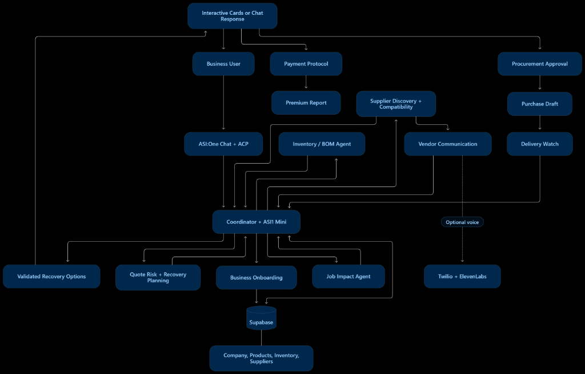
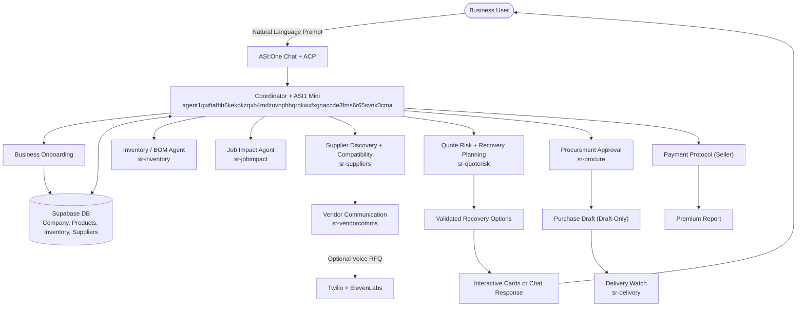

# StockRescue

<p align="center">
  
</p>


**Autonomous Multi-Agent Industrial Supply Chain Disruption Recovery**

This is not a simple chatbot. It is a synchronized team of specialist uAgents that detects critical material shortages, calculates factory downtime exposure, verifies OEM component compatibility, sources certified distributors, generates optimized recovery options, prepares draft purchase orders, and tracks inbound hot-shot couriers from a single message while your plant operates.

[Chat with @stockrescue on ASI:One](https://asi1.ai/) · [Agentverse Portal](https://agentverse.ai/) · [Supabase Console](https://supabase.com/)

---

## The Problem

Industrial maintenance and factory production suffer catastrophic losses when primary suppliers delay critical parts:

- **Unplanned Downtime:** Critical production lines incur thousands of dollars in hourly losses when single components fail to arrive.
- **Fragmented Inventories:** Stock counts are split across disconnected warehouses, bin locations, and committed production orders.
- **Supplier Volatility:** Relying on single-source suppliers exposes plant operations to unilateral delays and delivery breaches.
- **Spec Risk:** Substituting industrial parts (bearings, pipes, valves, motors) requires rigorous engineering verification of dimensions, pressure ratings, materials, and tolerances.
- **Procurement Safeguards:** Commercial teams cannot allow autonomous AI agents to charge corporate cards or place binding orders without strict human oversight.

---

## What StockRescue Does

Send one message to **@stockrescue** on ASI:One:

> *"Our main supplier delayed a critical component (PIPE-4IN-SCH40) and two jobs may be affected. Check our profile, investigate the shortage, and find the safest recovery plan."*

### Live Execution Timeline

| Time | Agent Execution Step |
|---|---|
| **0s** | **Coordinator + ASI1 Mini** reads your request, checks business profile & organization registration in Supabase, and correlates active case context (`CASE-PIPE-001`). |
| **8s** | **Inventory / BOM Agent** pulls physical stock (20 on hand, 15 committed, 5 available) against total demand (35 units) and flags a net shortage of 30 units. |
| **14s** | **Job Impact Agent** assesses line requirements: Line 1 Scheduled Maintenance (10 units uncovered) and Line 2 Expansion (20 units uncovered), flagging both for imminent downtime risk. |
| **24s** | **Supplier Discovery & Compatibility** excludes the failed supplier, discovers certified regional alternatives (Apex Industrial Supply, Midwest Piping Corp), and verifies exact OEM specification match. |
| **36s** | **Quote Risk & Recovery Planning** assesses freight options, lead times, pack multiples, and landed costs. Generates an optimal fast-track recovery plan ($1,395.00 total landed cost). |
| **45s** | **Interactive ACP Cards** render in ASI:One chat: Impact Detail Card, Plan Comparison Carousel, and Draft Purchase Order Card. |
| **60s** | **Vendor Communication & Voice** prepares structured RFQ drafts. Integrates with ElevenLabs and Twilio for automated phone inquiries (simulator mode during tests). |
| **90s** | **Procurement & Payment Protocol** prepares human-authorized purchase order draft `PO-DRAFT-SR-5FF464` and verifies seller-side Payment Protocol sandbox verification. |
| **120s** | **Delivery Watch** actively monitors carrier tracking milestones (`HOTSHOT-IND-9921`) to verify arrival prior to scheduled shift start. |

---

## Architecture





---

## The Specialist Agents: Registered on Agentverse

Every agent is a dedicated uAgent registered on the Fetch.ai Agentverse network:

| Agent Name | Agentverse Handle | Function & Responsibility | Address |
|---|---|---|---|
| **StockRescue Coordinator** | `stockrescue` | Conversational orchestrator, ASI1 Mini reasoning loop, card builder, HITL enforcement | `agent1qwftafhh6kekpkzqxh4mdzuvnphhqrqkwxfxgnaccde3fms6r65svnk0cma` |
| **Inventory & BOM** | `sr-inventory` | Physical stock vs committed balance calculation, net shortage quantification | `agent1qvwmvakw2y7s0u4vj2sqcgz9y7ty2fxrg8c5vvgzlw4r70mmz3xpuppm4cr` |
| **Job Impact** | `sr-jobimpact` | Work order criticality scoring, uncovered unit demand, deadline breach risk | `agent1qwpes68a2as0hh3yahxzz78266agt6ten4ykny3xmqcyc56fhkds7388fln` |
| **Supplier Discovery** | `sr-suppliers` | Certified supplier search, failed vendor blacklisting, OEM compatibility verification | `agent1q0ac6fztvpvzuf0kegpek9wl5qnuv26f29aeny7rluygkg56z9d0gygf3vh` |
| **Quote Risk & Planner** | `sr-quoterisk` | Multi-criteria optimization, landed cost calculation, single & split sourcing plans | `agent1q2nn70ng2g6d5ccpz87a3ng8kaswyu6me8c4tfjp4zfma0twztstgulm5mz` |
| **Procurement** | `sr-procure` | Safe draft purchase order assembly, cryptographic fingerprinting, operator approval | `agent1qggs7dy7ky0fza48dpwjqhfnfrrmq2mxg5d8hdvl8x064xhfhqdtwv82wzg` |
| **Vendor Voice & Comms** | `sr-vendorcomms` | Automated RFQ script generation, ElevenLabs voice synthesis, Twilio phone bridge | `agent1q2ts3pay9rd0zvyk6r5y4f46avu3zl5ft33yvdjv2fxta24k5the5vua4vr` |
| **Delivery Watch** | `sr-delivery` | Inbound tracking ingest, hot-shot logistics monitoring, schedule variance alerts | `agent1q29xxmnpfh4vkjanmhd7hzt4jgjxk6fhur2pwgzn85l6xcdfgpdcggkqlhx` |

*Profiles live at: `https://agentverse.ai/agents/details/<address>/profile`*

---

## How It Works

### 1. Agent Chat Protocol (ACP) & ASI1 Mini Reasoning
- Conversational interface powered by **ASI:One** running the `asi1-mini` model with `enable_thinking: true`.
- Evaluates inbound user requests and dynamically calls 13 approved specialist tools.
- Renders native **Agentverse Interactive Cards** (Form Cards, Detail Cards, Carousel Cards, Review Cards) directly within ASI:One chat.

### 2. Deterministic Business Logic Authority
- Physical inventory counts, bill-of-materials demand, technical compatibility, landed cost arithmetic, and delivery events are strictly grounded in deterministic Python modules.
- The LLM acts as an orchestrator and translator—never as an unchecked authority for stock counts, pricing, or safety approvals.

### 3. Human-in-the-Loop Procurement Safety
- **Strictly Draft-Only:** Real automated purchasing is disabled. All purchase orders are created as signed drafts requiring human operator review.
- Cryptographic canonical plan fingerprinting ensures purchase drafts match validated recovery plans.

### 4. Seller-Side Payment Protocol
- StockRescue implements the Fetch.ai Payment Protocol specification as a seller service for premium contingency reports.
- Employs on-chain / sandbox payment verification before unlocking premium audit reports, preventing unauthorized data release.

### 5. Telephony & Voice RFQ Bridge
- Vendor Communication Specialist integrates with **Twilio** media streams and **ElevenLabs Agents** (μ-law 8 kHz) to conduct automated commercial RFQ calls.
- Runs in simulation mode during evaluation testing with pre-recorded negotiation scripts.

---

## Required Resources & Services

Running and deploying StockRescue requires access to the following platforms and service credentials:

- **[Fetch.ai Agentverse](https://agentverse.ai/):** Cloud hosting environment for autonomous uAgents, Almanac identity indexing, and inter-agent mailbox routing.
- **[ASI:One Developer Platform](https://asi1.ai/):** API access for the `asi1-mini` reasoning model, Agent Chat Protocol (ACP), and interactive card rendering.
- **[Fetch.ai avctl CLI](https://fetch.ai/docs/tools/avctl):** Command-line deployment tool for deploying, packaging, and streaming logs from Agentverse hosted agents.
- **[Supabase (PostgreSQL)](https://supabase.com/):** Cloud relational database for storing verified organizations, business profiles, disruption cases, inventory positions, and audit events.
- **[ElevenLabs](https://elevenlabs.io/):** Conversational AI agents and voice generation for automated supplier quote calls.
- **[Twilio Telephony](https://www.twilio.com/):** SIP / media stream bridge connecting ElevenLabs voice agents to telephone carrier networks.
- **[Langfuse](https://langfuse.com/):** Production LLM observability, trace visualization, and tool execution latency monitoring.

---

## Quickstart

### Prerequisites
- Python 3.11 or Python 3.12
- Node.js 18+ (for frontend dashboard)
- PostgreSQL database (Supabase recommended)
- Fetch.ai `avctl` CLI tool installed
- Active accounts on Agentverse, ASI:One, and Supabase

### 1. Installation
```bash
git clone https://github.com/vivinarya/stockrescue.git
cd stockrescue
python -m venv .venv
source .venv/bin/activate  # On Windows: .venv\Scripts\activate
pip install -r backend/requirements.txt
```

### 2. Environment Configuration
Copy `.env.example` to `backend/.env` and configure:
```ini
ASI_ONE_API_KEY=your_asi_one_key
ASI_ONE_BASE_URL=https://api.asi1.ai/v1
ASI_ONE_MODEL=asi1-mini

# Database
DATABASE_BACKEND=postgres
WAREHOUSE_DATABASE_URL=postgresql://...
SUPABASE_URL=https://...

# Telephony & Voice
ELEVENLABS_API_KEY=your_key
TWILIO_ACCOUNT_SID=your_sid
TWILIO_AUTH_TOKEN=your_token
```

### 3. Run the Backend & Warehouse API
```bash
cd backend
python -m uvicorn services.warehouse_api.main:app --host 127.0.0.1 --port 8000 --reload
```

### 4. Run the Agents Locally or via Agentverse
Run local coordinator loop:
```bash
python -m agents.coordinator.agent
```

Deploy / synchronize agents with Agentverse cloud:
```bash
avctl hosting push -a agent1qwftafhh6kekpkzqxh4mdzuvnphhqrqkwxfxgnaccde3fms6r65svnk0cma -f agent.py,agentverse_entry.py,orchestrator.py,card_protocol.py,card_workflow.py
avctl hosting run -a agent1qwftafhh6kekpkzqxh4mdzuvnphhqrqkwxfxgnaccde3fms6r65svnk0cma
```

---

## Testing & Verification

Run the comprehensive test suite:
```bash
cd backend
pytest tests/ -v
```

Execute specialist tools integration verification:
```bash
python -c "
from agents.coordinator.agent import execute_coordinator_tool
print(execute_coordinator_tool('check_business_profile_and_case_context', '{}'))
print(execute_coordinator_tool('analyze_inventory_bom', '{\"case_id\": \"CASE-PIPE-001\"}'))
print(execute_coordinator_tool('generate_recovery_options', '{\"case_id\": \"CASE-PIPE-001\"}'))
"
```

---

## Repository Map

| Path | Description |
|---|---|
| `backend/agents/coordinator/` | Coordinator agent, ACP card protocol, and ASI1 Mini orchestrator |
| `backend/agents/inventory_bom/` | Inventory & Bill of Materials assessment specialist |
| `backend/agents/job_impact/` | Production job impact and downtime risk evaluator |
| `backend/agents/supplier_discovery/` | Certified supplier sourcing and vendor catalog query |
| `backend/agents/quote_risk/` | Multi-criteria quote evaluation and risk scoring |
| `backend/agents/recovery_planner/` | Single-source and split-source recovery option generator |
| `backend/agents/procurement/` | Purchase draft preparation and human approval controller |
| `backend/agents/vendor_voice/` | Voice RFQ calls and supplier inquiry drafting |
| `backend/agents/delivery_watch/` | Real-time logistics tracking and shipment monitoring |
| `backend/services/warehouse_api/` | FastAPI REST service, Supabase PostgreSQL repository |
| `backend/tools/` | Deterministic computation engines (inventory, compatibility, optimizer) |
| `backend/shared/` | Pydantic domain models, payment protocol contracts, settings |
| `frontend/` | React + TypeScript operator dashboard and interactive mission control |
| `docs/` | System architecture documentation and visual diagrams |

---

## Built With

- **Fetch.ai uAgents & Agentverse:** Distributed autonomous agent hosting, Almanac registry, and mailbox transport.
- **ASI:One & ASI1 Mini:** Agent Chat Protocol (ACP) conversational reasoning and tool execution.
- **FastAPI & PostgreSQL (Supabase):** Enterprise inventory repository, disruption tracking, and audit persistence.
- **Pydantic v2:** Cryptographic fingerprinting and deterministic schema validation.
- **ElevenLabs & Twilio:** Conversational voice synthesis and telephony media streaming.
